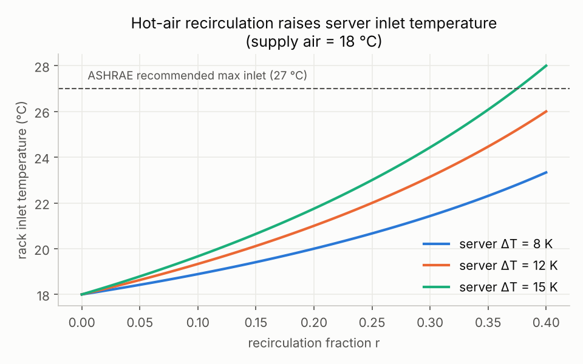
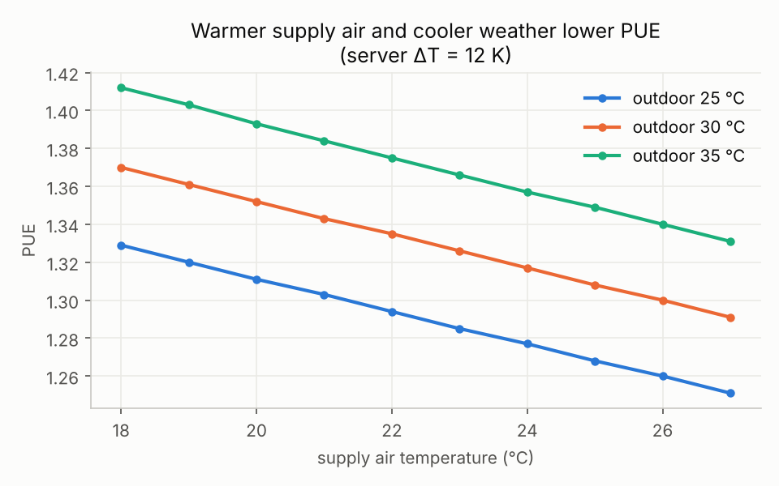
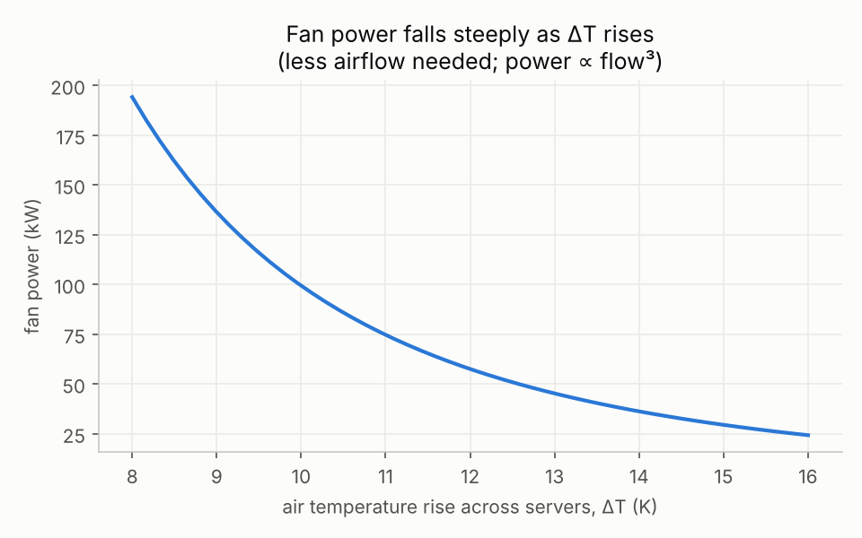
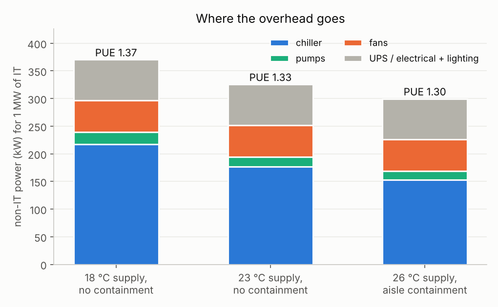

# Data Center Rack Cooling & PUE Model

This is a first-principles Python model of an **air-cooled data center**. It estimates how much airflow the servers need, how hot-air recirculation affects server inlet temperatures, and how cooling choices change **Power Usage Effectiveness (PUE)**.

All the physics is steady-state energy balance: Q = ṁ·cp·ΔT, mixing, fan laws and a Carnot-based chiller COP. It is a **design-stage estimate, not a CFD simulation**, and every assumption is a parameter you can change.

## The physics

**1. Airflow to remove server heat.** All IT power becomes heat, which the air carries away:

> ṁ = P_IT / (cp · ΔT_server) → for 1 MW at ΔT = 12 K: ṁ ≈ 83 kg/s ≈ 69 m³/s

**2. Hot-air recirculation.** Without aisle containment, some hot exhaust air leaks back into the cold aisle. If a fraction *r* of the inlet air is recirculated exhaust, the mixing energy balance is:

> T_in = (1 − r)·T_supply + r·(T_in + ΔT) ⟹ **T_in = T_supply + r·ΔT / (1 − r)**

Servers should stay at or below **27 °C inlet** (the ASHRAE recommended range), so recirculation sets an upper limit on the supply temperature.

**3. Fan power.** P_fan = V̇·Δp / η. In a fixed duct system Δp ∝ V̇², so **P_fan ∝ V̇³**. Doubling ΔT halves the airflow and cuts fan power by a factor of 8.

**4. Chiller COP.** Modeled as a fraction of the Carnot COP:

> COP = η_c · T_evap / (T_cond − T_evap), with T_evap = T_supply − 9 K and T_cond = T_outdoor + 8 K

Warmer supply air or cooler outdoor air narrows the temperature lift, so the COP goes up.

**5. PUE** = (IT + fans + chiller + pumps + UPS losses + lighting) / IT. An ideal facility has a PUE of 1.0.

## Assumptions (all set in `dc_model.Assumptions`)

| Parameter | Value | Note |
|---|---|---|
| IT load | 1000 kW | results scale per MW |
| Server ΔT | 12 K | typical range 10–15 K |
| Recirculation, no containment / with containment | 0.25 / 0.05 | assumed; real values come from measurement or CFD |
| Fan Δp at design flow, fan efficiency | 500 Pa, 0.60 | |
| Carnot fraction, evap / cond approach | 0.50, 9 K / 8 K | |
| Pumps + cooling tower | 10% of chiller power | |
| UPS / distribution efficiency | 94% | |
| Outdoor temperature | 30 °C (25 and 35 °C also swept) | |

## Results

`run_analysis.py` evaluates **120 scenarios** (supply air 18–27 °C × server ΔT 8–15 K × outdoor 25/30/35 °C). PUE ranges from **1.22 to 1.58**, and chiller COP from 4.2 to 9.7.

**Containment study** (1 MW IT, ΔT = 12 K, outdoor 30 °C):

| Case | Max supply air | Rack inlet | COP | PUE |
|---|---|---|---|---|
| Legacy 18 °C setpoint, no containment | 18 °C | 22.0 °C | 4.86 | 1.370 |
| No containment, setpoint raised to the limit | 23 °C | 27.0 °C | 5.98 | 1.326 |
| Aisle containment, setpoint raised | 26 °C | 26.6 °C | 6.91 | **1.300** |

- At the same 18 °C supply, containment lowers rack inlet temperature by **3.4 °C**.
- Containment on its own saves no energy. Its benefit is that it lets the supply air run **3 °C warmer** while staying within ASHRAE limits. Warmer supply air means a higher chiller COP.
- Compared with a legacy 18 °C setpoint, containment plus a raised setpoint cuts PUE from 1.37 to 1.30. That is about **620 MWh per year per MW of IT**.
- Server ΔT is the other big lever. Going from 8 K to 12 K cuts fan power by about 70% (the cube law).






## Limitations
- The recirculation fractions are assumed. In a real facility they come from sensor data or CFD, and they vary from rack to rack.
- The model is steady-state and uses a single outdoor temperature. A yearly analysis would use hourly weather data, which would also show economizer ("free cooling") hours.
- The COP model is a scaled Carnot cycle, not a manufacturer's chiller curve.

## Run it
```bash
pip install -r requirements.txt
python run_analysis.py      # writes results/ and figures/
python -m pytest -q         # physics sanity checks (energy balance, fan cube law, ...)
```

## Files
- `dc_model.py`: the physics model
- `run_analysis.py`: the scenario sweep, the containment study and the figures
- `test_dc_model.py`: unit tests that check the energy balances
- `results/`: CSV outputs
