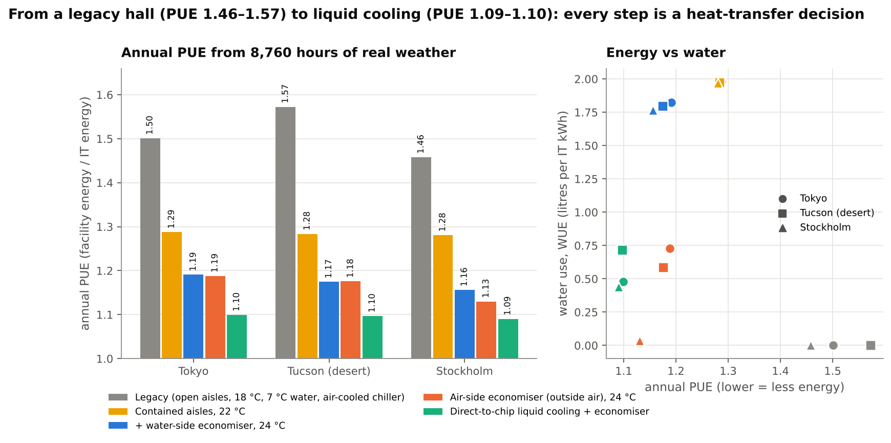
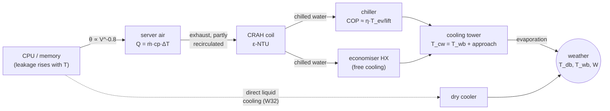
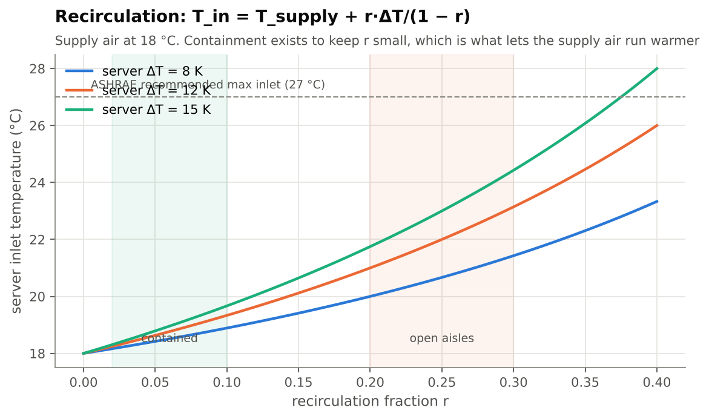
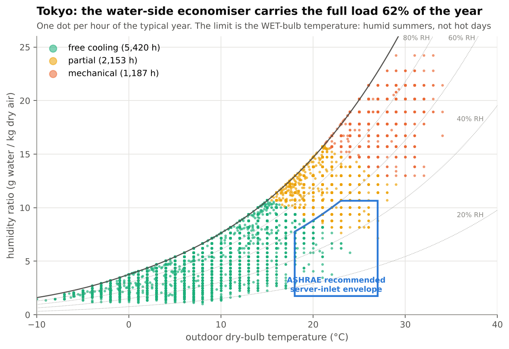
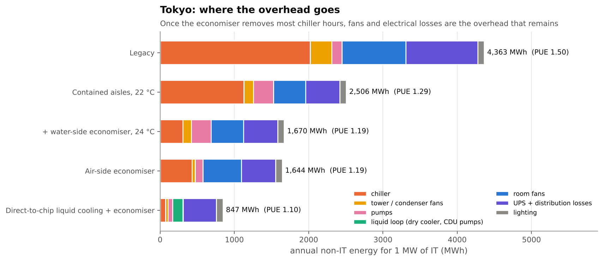
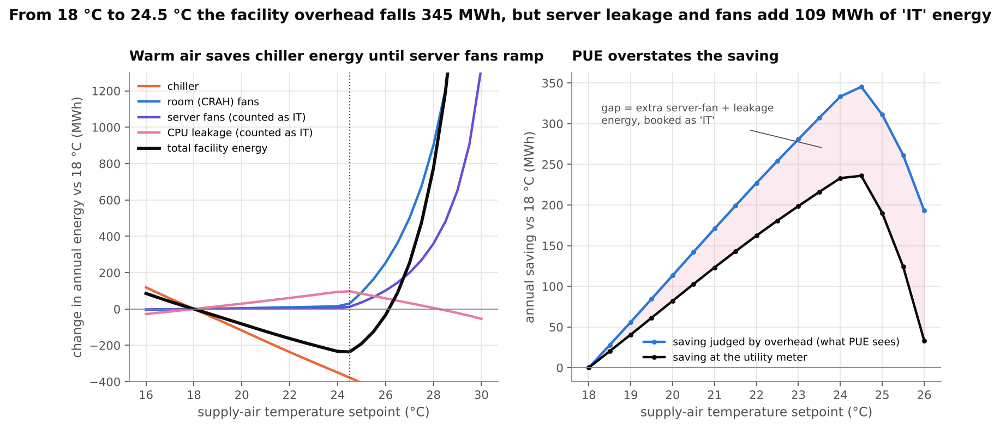
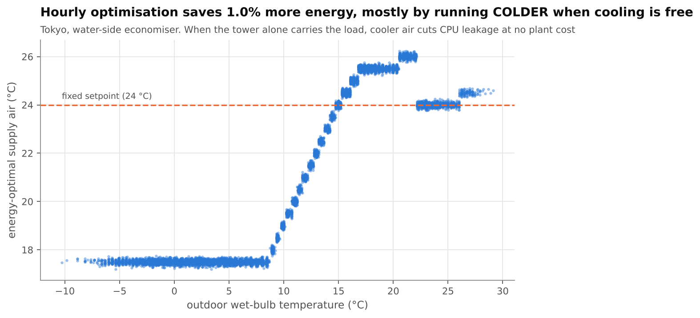
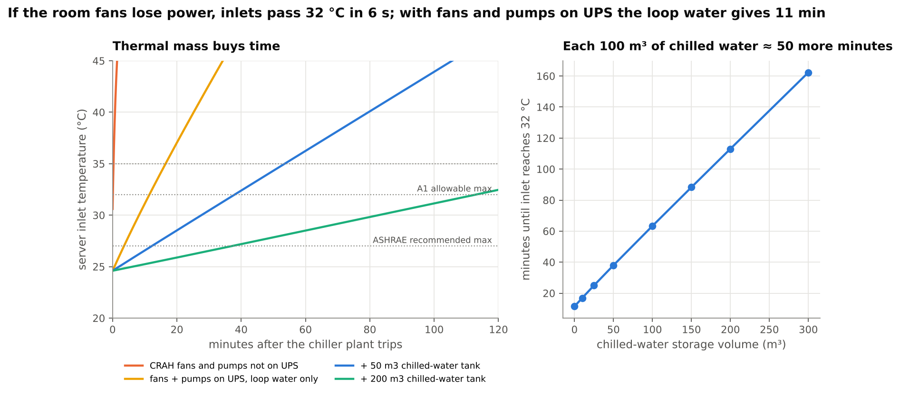
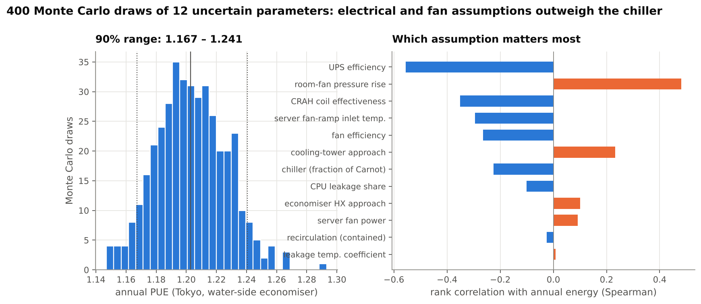

# Data Center Cooling: an Hour-by-Hour Thermal and Energy Model

A first-principles Python model of a 1 MW data hall. It follows the heat from the processors, through the server air, the room air, the chilled-water coil, the chiller or economiser, and out to the weather. It is run for **all 8,760 hours of a typical weather year** in three climates (Tokyo, the Arizona desert, Stockholm) and five cooling designs.

There is no CFD and no black-box simulator. Every result comes from energy balances, heat-exchanger effectiveness, psychrometrics and the fan laws, all written out below. Each one is checked by a unit test.

<p align="center"></p>

**What the model shows**

| Question | Answer (1 MW of IT) |
|---|---|
| How much does each design step save? | Tokyo PUE: **1.50 → 1.29 → 1.19 → 1.10**, for legacy → contained aisles → water-side economiser → direct liquid cooling. Legacy to economiser saves **2,650 MWh a year (−20%)**. |
| What limits free cooling in Tokyo? | The **wet-bulb** temperature, not the dry-bulb. The economiser carries the whole load **62% of the year** and part of it for another 25%. |
| Is warmer supply air always better? | No. Total energy is lowest at **24.5 °C supply air**. Above that, server fans and room fans follow a cube law, and at 27 °C the hall uses **+490 MWh/yr** more. |
| Does PUE tell the truth? | Not quite. From 18 to 24.5 °C, overhead falls 345 MWh but servers draw **109 MWh more** (fans and CPU leakage), which counts as "IT". PUE overstates the saving by about 46%. |
| What does model-based optimisation add? | Choosing the setpoint every hour saves **another 1.0%**. It mostly does this by running **cooler** when cooling is free. |
| What if the chiller trips? | If the room fans are not on UPS, server inlets pass 32 °C in **6 seconds**. With fans and pumps on UPS, the loop water buys **11 minutes**. Each 100 m³ of chilled-water storage adds about **50 minutes**. |
| Which assumption matters most? | Over 400 Monte Carlo runs, **UPS efficiency and fan pressure drop** dominate. Once the economiser has removed most chiller hours, the chiller model matters much less. |

---

## 1. The physics



### Server side: the part most PUE models leave out

**1. Air temperature rise.** All IT power ends up as heat carried by the air:

$$\dot m_{srv} = \frac{P_{IT}}{c_p\,\Delta T_{srv}}$$

**2. Recirculation.** Without containment, hot exhaust leaks back to the cold aisle. If a fraction r of the inlet air is exhaust, a mixing energy balance gives:

$$T_{in} = (1-r)\,T_{sa} + r\,(T_{in}+\Delta T_{srv}) \;\Rightarrow\; T_{in} = T_{sa} + \frac{r\,\Delta T_{srv}}{1-r}$$

<p align="center"></p>

**3. Server fan control.** Server fans sit at minimum speed until the inlet reaches about 25 °C. Above that, they speed up to cap the exhaust temperature. ΔT then shrinks, airflow rises, and fan power rises as airflow cubed (affinity laws):

$$\Delta T_{srv} = \min\big(\Delta T_{nom},\; T_{ex,max} - T_{in}\big), \qquad P_{fan} \propto \dot V^3$$

**4. CPU temperature and leakage.**

- The CPU sits a thermal resistance above the local air. For turbulent forced convection over a heat sink, h ∝ Re^0.8, so the case-to-air rise scales as V^−0.8.
- Sub-threshold leakage current grows roughly exponentially with temperature. Here it doubles every 20 K (β = 0.035 K⁻¹).

$$T_{cpu} = T_{in} + \tfrac{1}{2}\Delta T_{srv} + \theta_0\left(\frac{\dot m}{\dot m_{nom}}\right)^{-0.8}, \qquad P_{leak} = L_{ref}\, e^{\beta (T_{cpu}-T_{ref})}$$

Server fans and leakage are counted as **IT power**. That is exactly why PUE can mislead (section 4).

### Room and chilled-water side

**5. CRAH fans.** Duct pressure drop scales as V̇², so fan power scales as V̇³:

$$P = \dot V\,\Delta p/\eta, \qquad \Delta p \propto \dot V^2 \;\Rightarrow\; P \propto \dot V^3$$

**6. CRAH coil (effectiveness-NTU).** Air is the minimum-capacity stream, so the chilled water must be colder than the supply air by a margin set by ε:

$$T_{sa} = T_{ra} - \varepsilon\,(T_{ra} - T_{chws}) \;\Rightarrow\; T_{chws} = T_{ra} - \frac{T_{ra}-T_{sa}}{\varepsilon}$$

Warmer supply air therefore allows warmer chilled water, and every degree of chilled-water temperature raises the chiller's COP.

**7. Chiller.** The chiller is modelled as a fraction of the Carnot COP. The lift is passed through a smooth maximum with the compressor's minimum lift, so the COP saturates instead of diverging when the lift is small:

$$\text{COP} = \eta_c\,\frac{T_{ev}}{\big(\text{lift}^4 + \text{lift}_{min}^4\big)^{1/4}}, \qquad \text{lift} = T_{cond}-T_{ev}$$

**8. Cooling tower and water-side economiser.**

- A wet cooling tower can only approach the **wet-bulb** temperature: T_cw = T_wb + 4 K.
- A plate heat exchanger (1.5 K approach) pre-cools the chilled-water return whenever tower water is colder than it.
- The economiser carries the fraction

$$f_{free} = \text{clip}\!\left(\frac{T_{chwr} - (T_{cw}+a_{hx})}{T_{chwr}-T_{chws}},\,0,\,1\right)$$

and the chiller handles the rest.

**9. Air-side economiser.** Outside air is used directly when it is cool enough. Its humidity is checked at the **server inlet**: the inlet air has the outdoor humidity ratio, but at the inlet temperature. It must satisfy ASHRAE's recommended envelope (dew point ≤ 15 °C, RH ≤ 60%). Very dry air is humidified adiabatically, which costs water but almost no energy.

**10. Psychrometrics.** These follow ASHRAE Fundamentals (2017), chapter 1:

- saturation pressure from the Hyland–Wexler equations;
- humidity ratio W = 0.621945·p_w/(p − p_w);
- the thermodynamic wet bulb, solved from the adiabatic-saturation balance by bisection.

**11. Direct-to-chip liquid cooling.**

- Cold plates take 75% of the IT heat on a 32 °C facility-water loop (ASHRAE class W32).
- A dry cooler rejects it whenever T_db + 6 K < 40 °C return. Otherwise tower water or the chiller trims the load.
- The CPU sits about 22 K above the coolant, so it runs cooler than under air, and leakage falls.

**12. Water use.**

- Tower make-up water = evaporation + blow-down.
- Evaporation ≈ 85% of rejected heat ÷ h_fg (2.45 MJ/kg).
- Blow-down = evaporation/(cycles − 1), with 4 cycles of concentration.
- The result is reported as **WUE**: litres per IT kWh (The Green Grid).

All parameters live in one dataclass, [`dccool/plant.py → Params`](dccool/plant.py), each with its source or reasoning in a comment.

---

## 2. Weather: why Tokyo is a wet-bulb problem

<p align="center"></p>

The model reads hourly EnergyPlus weather files and computes the wet bulb from dry bulb, dew point and pressure. The three climates are Tokyo (IWEC), Tucson in Arizona (TMY3) and Stockholm (IWEC).

On the psychrometric chart, Tokyo's summer hours sit close to saturation. A cooling tower cannot cool water below the wet bulb, so the economiser's limit is the **humid** summer, not the hot days:

| Climate | Wet bulb low enough for full free cooling | Partial |
|---|---|---|
| Tokyo | 5,420 h (62%) | 2,153 h |
| Tucson | 6,415 h | 2,184 h |
| Stockholm | 8,372 h | 388 h |

Tucson is hot but dry, so its wet bulb is low. That gives it *more* free-cooling hours than Tokyo, despite a 42 °C peak.

The air-side economiser in Tokyo shows the same humidity limit from another angle. It gets 5,533 hours of full free cooling but only **23 partial hours**. Tokyo's mild air is usually too humid to bring inside, so outside air works only when it is both cool *and* dry.

---

## 3. Annual results: five designs, three climates

| Design | Tokyo PUE | Tucson PUE | Stockholm PUE | Tokyo energy (MWh/yr) | Tokyo WUE (L/kWh) |
|---|---|---|---|---|---|
| Legacy: open aisles, 18 °C supply, 7 °C water, air-cooled chiller | 1.50 | 1.57 | 1.46 | 13,070 | 0 |
| Contained aisles, 22 °C, water-cooled chiller | 1.29 | 1.28 | 1.28 | 11,224 | 1.98 |
| + water-side economiser, 24 °C | 1.19 | 1.17 | 1.16 | 10,423 | 1.82 |
| Air-side economiser, 24 °C | 1.19 | 1.18 | 1.13 | 10,397 | 0.73 |
| Direct-to-chip liquid cooling + economiser | 1.10 | 1.10 | 1.09 | 9,372 | 0.48 |

<p align="center"></p>

**What the breakdown shows:**

- **Containment saves energy indirectly.**
  - Keeping recirculation low lets the supply air run warmer at the same inlet temperature, which allows warmer chilled water and a better chiller COP.
  - The legacy hall's 7 °C chilled water also forces large lifts all year.
- **The economiser removes most of what is left of the chiller.** In Tokyo, chiller energy falls from 1,129 to 305 MWh. What remains is fans (438 MWh) and UPS/distribution losses (461 MWh), so electrical efficiency becomes the next lever.
- **Energy and water trade off** (right panel of the first figure).
  - Evaporative cooling towers use about 1.8 L of water per IT kWh. Air-side economisers and liquid cooling use far less.
  - Stockholm's air-side economiser uses almost none (0.03 L/kWh).
  - In water-stressed regions the "best" design changes.
- **Liquid cooling wins twice.**
  - Water carries heat with about 3,500 times the volumetric heat capacity of air, so room fans almost disappear (6 MWh/yr).
  - A 32 °C loop can reject heat to dry air on most hours.
  - The CPUs also run cooler, which cuts IT energy by 228 MWh/yr: leakage drops 93 MWh and server fans 134 MWh. PUE does not credit this saving at all.

---

## 4. The supply-air setpoint: an optimum, and a trap in PUE

<p align="center"></p>

Sweeping the supply-air setpoint for the Tokyo economiser design gives this picture:

| Supply air (°C) | Server inlet (°C) | Annual energy (MWh) | PUE | Server fans + leakage (MWh) | Room fans (MWh) |
|---|---|---|---|---|---|
| 18 | 18.6 | 10,656 | 1.232 | 594 | 423 |
| 22 | 22.6 | 10,494 | 1.204 | 658 | 433 |
| **24.5** | **25.1** | **10,420** | **1.189** | 703 | 454 |
| 26 | 26.6 | 10,623 | 1.205 | 754 | 677 |
| 27 | 27.5 | 10,910 | 1.228 | 826 | 924 |

- **There is an optimum, and it sits at the server fan-ramp knee.**
  - Below it, every degree of warmer air saves chiller energy and adds a little CPU leakage.
  - Above it, server fans speed up to hold their exhaust temperature. Because room airflow must match server airflow, the CRAH fans speed up too, and both follow the cube law.
  - Running at the top of the ASHRAE recommended range (27 °C inlet) costs 4.7% more energy than the optimum.
- **PUE hides part of the cost of warm air.**
  - From 18 °C to 24.5 °C, the overhead falls by 345 MWh.
  - Over the same change, the servers draw 109 MWh more, and that energy is booked as "IT".
  - The utility meter sees a 236 MWh saving, but judging by PUE you would claim 345 MWh.
  - This is the case for metrics like **ITUE/TUE** (Patterson et al.), which also count the cooling energy *inside* the server.

---

## 5. Model-based optimisation: choosing the setpoint every hour

<p align="center"></p>

**How the optimiser works.** For every hour it searches supply-air setpoints from 17 to 27 °C. It keeps only those that hold the server inlet inside the ASHRAE recommended range (18–27 °C) and picks the one with the lowest *total* facility power, including server fans and leakage.

**The policy that comes out is not "as warm as possible":**

| Outdoor wet bulb | What the optimiser does | Why |
|---|---|---|
| Below ~8 °C | runs at the **coldest** allowed setpoint | The tower carries the whole load at any setpoint, so cooler air is free and cuts CPU leakage. |
| 8–22 °C | raises the setpoint steadily, up to 26 °C | Each degree buys economiser hours, which is worth running the fans harder. |
| Above ~22 °C | drops back to about 24 °C | The economiser is off at any setpoint, so warm air only helps the chiller's COP. Fan power outweighs that above the knee. |

| | Tokyo, water-side economiser | Tokyo, air-side economiser | Stockholm, air-side economiser |
|---|---|---|---|
| Energy saved vs fixed 24 °C | 1.0% (101 MWh/yr) | 0.8% (79 MWh/yr) | 1.2% (123 MWh/yr) |
| Mean setpoint chosen | 21.1 °C | 20.0 °C | 18.1 °C |

For the Tokyo air-side design, the optimised plant uses 79 MWh less energy, yet its PUE gets slightly *worse*: 1.1879 against 1.1878. This is a concrete case of the PUE trap from section 4.

Here the optimiser has a perfect model and perfect forecasts, so 1% is an upper bound for this plant. In practice the model would be calibrated from building-management-system (BMS) data, or replaced by a machine-learned surrogate. That is how AI-based energy optimisation is usually built.

---

## 6. Transient: how long can the servers ride through a chiller trip?

<p align="center"></p>

[`dccool/transient.py`](dccool/transient.py) is a lumped-capacitance model with four nodes:

- server mass: 60 t at 600 J/(kg K);
- hall air: 3,000 m³;
- building slab: 250 MJ/K;
- chilled-water inventory: 20 m³ of loop water, plus an optional storage tank.

The nodes are joined by the server conductance UA = 35 kW/K, derived from the 29 K CPU-to-air rise at 1 MW, and by the coil effectiveness. While the fans run, the air loop is quasi-steady, because air circulates in seconds and the masses heat up over minutes.

| After a chiller-plant trip at 1 MW | Inlet reaches 27 °C | 32 °C (A1 allowable) | 35 °C |
|---|---|---|---|
| CRAH fans and pumps **not** on UPS | immediately | **6 s** | 18 s |
| Fans and pumps on UPS, loop water only | 3.6 min | **11.5 min** | 16.5 min |
| + 50 m³ chilled-water tank | 12 min | 38 min | 54 min |
| + 200 m³ tank | 37 min | 113 min | 158 min |

**Why it behaves this way:**

- **Air has almost no heat capacity.** 3,000 m³ of air stores only 3.6 MJ/K, and the hall's IT load alone heats it at 0.3 K/s.
- **Containment makes this worse.** The cold aisle is a small volume, and once the fans stop the hot aisle mixes into it within seconds.
- **The fans and pumps must therefore be on the UPS.** With them running, the chilled-water loop becomes the heat sink.
- **Storage buys time linearly.** Its capacity is ρ·c_p·V = 4.2 MJ/K per m³, so each 100 m³ adds about 50 minutes at 1 MW. That is enough time for generators and chillers to restart.
- **Sensible storage is cheap insurance.** This is why chilled-water storage tanks are standard in Tier III/IV designs.

---

## 7. Uncertainty: which assumptions matter?

<p align="center"></p>

Twelve parameters were sampled uniformly over plausible ranges in 400 runs, for example a chiller Carnot fraction of 0.35–0.55, a tower approach of 3–6 K, and a fan-ramp threshold of 23–27 °C.

- **The spread.** Tokyo's annual PUE with the water-side economiser has a **90% range of 1.167–1.241** (median 1.203). The default parameters (1.191) sit on the optimistic side of that range.
- **What drives it** (ranked by Spearman correlation with annual energy):

| Parameter | Spearman ρ |
|---|---|
| UPS efficiency | −0.56 |
| Room-fan pressure rise | +0.48 |
| Coil effectiveness | −0.35 |
| Server fan-ramp temperature | −0.30 |
| Chiller fraction of Carnot | only −0.23 |

- **What it means.** In an economised plant the chiller runs rarely, so its efficiency matters less than the parts that run 8,760 hours a year.

---

## Validation

[`tests/test_physics.py`](tests/test_physics.py) (run `python -m pytest -q`) checks:

- **Psychrometrics against ASHRAE.** Saturation pressure matches ASHRAE Fundamentals Table 3 at 0.01, 20, 40 and −10 °C (over ice) within 0.2%. The wet bulb at 30 °C / 50% RH is 22.0 °C, and the wet bulb equals the dry bulb at saturation.
- **Recirculation.** The recirculation mixing balance holds.
- **Energy balances close.** They close for the server airflow and the room air (Q = ṁ·c_p·ΔT, exactly), and for the transient model: 1,800 s of heat input equals the stored energy within 1%.
- **Server fans.** They stay at minimum below the ramp threshold and more than double above it.
- **Chiller.** The COP is below the Carnot COP at every operating point.
- **Economiser.** It carries 100% of the load in cold dry weather and 0% in hot humid weather.
- **Power accounting.** The power components sum to the total, and PUE > 1.

## Limitations

- **No CFD.** Recirculation is a single number per design: 0.05 contained, 0.25 open. Real halls have hot spots that vary rack by rack, and that is what CFD or sensor data are for.
- **Component curves are physics-based approximations, not manufacturer data.**
  - Chiller: a Carnot fraction with a minimum lift.
  - Tower: a fixed approach.
  - Fans: affinity laws.
  - A detailed design would use vendor part-load curves (for example the DOE-2 chiller model).
- **Constant IT load.** Real IT load varies through the day, and part-load fan and chiller behaviour would matter.
- **Server thermal parameters are typical, not measured.** These are the fan-ramp threshold, the leakage fraction and the CPU thermal resistance. The Monte Carlo study (section 7) shows how much they matter.
- **The ride-through model ignores restart sequencing.** Chillers need minutes to restart after power returns, and that delay should be added to the times above.
- **Weather.** Typical-year files (IWEC/TMY3) contain no extreme years. Design-day peaks need extreme-condition data.

## Questions to be ready for

<details><summary><b>Why does the economiser depend on the wet bulb rather than the dry bulb?</b></summary>

A wet cooling tower cools water by evaporation. The coldest water it can make approaches the air's wet-bulb temperature, the temperature of adiabatic saturation, not the dry bulb. Humid air (Tokyo in summer) has a high wet bulb even at moderate dry-bulb temperatures.
</details>

<details><summary><b>Why does fan power go as the cube of the flow?</b></summary>

In a fixed duct system the pressure drop is turbulent, Δp ∝ ρV²/2 ∝ V̇². Fan power is V̇·Δp/η, so it scales as V̇³. Halving the airflow (by doubling ΔT) cuts fan power to 1/8.
</details>

<details><summary><b>Why is PUE misleading when you raise the setpoint?</b></summary>

PUE = facility energy / IT energy, and IT energy includes the server fans and CPU leakage, which both rise with inlet temperature. Raising the setpoint moves energy from the numerator's "overhead" part into the "IT" part. PUE improves by more than the actual saving, and it can improve while total energy rises.
</details>

<details><summary><b>Why does containment save energy if it does not remove any heat?</b></summary>

It reduces recirculation r. Server inlet = supply + r·ΔT/(1 − r), so with lower r the supply air can be warmer for the same inlet limit. Warmer supply air allows warmer chilled water through the coil's ε relation, which lowers the chiller's lift and raises its COP. It also extends economiser hours.
</details>

<details><summary><b>Why is the lumped-capacitance (single-temperature) model acceptable for the transient?</b></summary>

The Biot number Bi = hL/k is small for thin sheet metal and aluminium heat sinks (h ~ 50 W/m²K, L ~ mm, k ~ 200 W/mK gives Bi ≪ 0.1). Conduction inside each part is much faster than convection from it, so one temperature per node is fair. The concrete slab is the weakest approximation (thick, low conductivity), but over the seconds to minutes that matter it absorbs only a few percent of the heat.
</details>

<details><summary><b>Why does liquid cooling also lower IT power?</b></summary>

Water's volumetric heat capacity (about 4.2 MJ/m³K) is about 3,500 times that of air (about 1.2 kJ/m³K). Cold plates hold the CPU cooler (here 54 °C instead of 60 °C), so the exponential leakage term falls. Most server-fan work also disappears, since only 25% of the heat still goes to air and fan power ∝ flow³.
</details>

## Run it

```bash
pip install -r requirements.txt
bash data/fetch_weather.sh     # downloads the three EPW weather files (IWEC data are (c) ASHRAE, so not committed)
python run_analysis.py         # ~15 s: writes results/
python make_figures.py         # writes figures/
python -m pytest -q            # physics checks
```

Any other EnergyPlus `.epw` file works: add it to `CLIMATES` in [`dccool/weather.py`](dccool/weather.py). For example, an ISHRAE file for an Indian city.

## Files

```
dccool/
  psychro.py     ASHRAE psychrometrics: saturation pressure, humidity ratio, wet bulb, dew point
  plant.py       servers (fans, leakage), CRAH, chiller, tower, economisers, liquid cooling -- vectorised over hours
  scenarios.py   the five cooling designs
  transient.py   ride-through ODE model (scipy solve_ivp)
  weather.py     EPW reader
run_analysis.py  annual simulations, setpoint sweep, hourly optimisation, ride-through, Monte Carlo
make_figures.py
tests/test_physics.py
results/         every number in this README
figures/
```

## References

- ASHRAE (2017). *Handbook — Fundamentals*, ch. 1 Psychrometrics (Hyland–Wexler saturation pressure, wet-bulb equation).
- ASHRAE TC 9.9 (2021). *Thermal Guidelines for Data Processing Environments*, 5th ed. (recommended envelope 18–27 °C, dew point ≤ 15 °C, RH ≤ 60%; class A1 allowable up to 32 °C; liquid-cooling classes W17–W45).
- The Green Grid. *PUE: A Comprehensive Examination of the Metric* (WP#49) and *Water Usage Effectiveness (WUE)* (WP#35).
- Patterson, M. et al. (2013). TUE, a new energy-efficiency metric applied at ORNL's Jaguar. *ISC* (ITUE/TUE).
- El-Sayed, N. et al. (2012). Temperature management in data centers: why some (might) like it hot. *ACM SIGMETRICS* (server power vs inlet temperature).
- Incropera, F. et al. *Fundamentals of Heat and Mass Transfer* (ε-NTU method, forced-convection correlations, lumped capacitance and the Biot number).
- Barroso, L., Hölzle, U. & Ranganathan, P. *The Datacenter as a Computer* (3rd ed.), ch. 5 (cooling and power).
